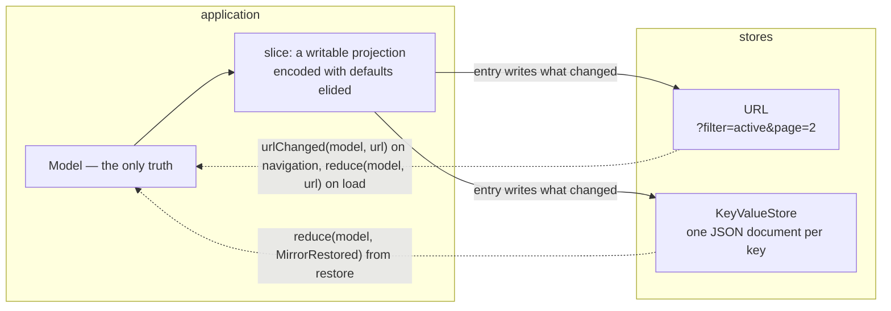

# Mirrored state: keep URL, storage, and cookies in step with your Model

A list filter or search query belongs in the URL so people can share a link. A half-written draft or collapsed sidebar belongs in browser storage so it survives a reload. A cart or theme preference belongs in a cookie so a server can read it on the first request. Keeping any of these stores by hand quickly turns into a second source of truth: the address bar disagrees with your `Model`, every parameter duplicates parsing and defaults, and browser back/forward navigation triggers write-after-read loops.

`foldkit-mirror` solves this by keeping your `Model` as the only truth and deriving the external store from it. You declare which `Model` fields belong to a **URL mirror** (`Mirror.url`), a **key-value mirror** (`Mirror.kv`), or a **cookie mirror** (`Mirror.cookie`); the mirror writes only when those fields change and folds navigation or cold-load values back into your `Model` through `update`.

## How a mirror works without creating a second store



Start by declaring one mirror for query parameters and one for browser storage over your application's `Model` (assuming your app defines `Model`, `Message`, `initial`, `update`, and `userId`):

<!-- docs-check
import { Match, Schema } from 'effect'
import type { KeyValueStore } from 'effect/persistence'
import { defineMessageUnion } from 'foldkit/message'
import * as Subscription from 'foldkit/subscription'
import type * as Update from 'foldkit/update'
import { Url } from 'foldkit/url'
import { Surface } from 'foldkit-surface'
import { Mirror } from 'foldkit-mirror'
const Model = Schema.Struct({
  filter: Schema.Literals(['all', 'active', 'done']),
  page: Schema.Number,
  q: Schema.String,
  sidebar: Schema.Literals(['open', 'closed']),
  draft: Schema.String,
})
type Model = typeof Model.Type
const Message = defineMessageUnion({ ...Mirror.messages, UrlChanged: { url: Url } })
type Message = typeof Message.Type
const initial: Model = { filter: 'all', page: 1, q: '', sidebar: 'open', draft: '' }
const update = (model: Model, _message: Message): Update.Return<Model, Message, KeyValueStore.KeyValueStore> => ({ model })
const App = Surface.application({ Model, Message, initial, update })
declare const userId: string
-->

```ts
const Filters = Mirror.url(App, {
  fields: [App.model.filter, App.model.page, App.model.q],
  keys: { q: { history: 'replace' } },
})

const Prefs = Mirror.kv(App, {
  key: 'todo/prefs',
  scope: userId,
  fields: [App.model.sidebar, App.model.draft],
})
```

When your app updates `filter` to `'active'` and `q` to `'milk'` while `page` stays at its initial `1`, the address bar becomes `?filter=active&q=milk` (omitting `page` because it matches the default, and replacing the history entry as you type `q`). Typing a draft writes `{"sidebar":"open","draft":"Buy oat milk"}` to `KeyValueStore` under the scoped key `todo/prefs:<userId>`.

To wire both mirrors into your `update` and `subscriptions`, fold `Mirror.reduces(message)` for storage restoration and `UrlChanged` for navigation, then spread both subscription records:

```ts
function handleMirror(
  model: Model,
  message: Message,
): Update.Return<Model, Message, KeyValueStore.KeyValueStore> {
  if (Mirror.reduces(message)) return { model: Prefs.reduce(model, message) }
  return Match.value(message).pipe(
    Match.tag('UrlChanged', ({ url }) => ({ model: Filters.urlChanged(model, url) })),
    Match.orElse(() => ({ model })),
  )
}

const subscriptions = Subscription.make<
  Model,
  Message,
  KeyValueStore.KeyValueStore
>()(() => ({
  ...Filters.subscriptions,
  ...Prefs.subscriptions,
}))
```

Under `Sync.mount`, pass `init: (model, url) => Filters.reduce(model, url)` and `onUrlChange` in the `url` option, and include both entries in `subscriptions` and your store layer in `resources`. Or let [Page.assemble](./wiring.md) derive `update`, `subscriptions`, and `url` from `Filters.wiring('UrlChanged')` and `Prefs.wiring()`.

## Why keeping the Model authoritative prevents drift

- **Defaults stay out of the URL:** `App.initial` defines every field's default, so any field matching its initial value is removed from the store. Pass `keys: { page: { keep: true } }` when a default value should stay visible in the URL.
- **No navigation loops:** Each subscription tracks the encoded key string as its dependency. One `Model` change triggers at most one store write, and a `popstate` navigation reduces the URL back into the `Model`, produces the identical key string, and stops.
- **Automatic codecs:** String, number, and boolean fields encode directly as readable query values, while complex fields use JSON unless you provide a custom `keys: { tags: { codec } }`.
- **Safe link building:** `Filters.href(model, { page: 2 })` computes a link from the live `Model` with only the target key changed, instead of concatenating query strings by hand.

## How values load back at startup

On a cold load, a URL mirror's `reduce(model, url)` sets every field in its slice: missing keys or keys that fail to decode (such as `?page=abc`) fall back to their initial value instead of breaking the page.

A store mirror's `reduce(model, message)` handles the `MirrorRestored` message produced by `Prefs.restore` and writes only fields still at their initial value, preserving edits a user made before storage answered. When a cold load has both, the URL takes precedence, followed by stored values, followed by `App.initial`.

If stored keys are already available at boot (for example, from server-embedded Flags or a synchronous read), call `Prefs.bootstrap(keys)` or `Mirror.bootstrap(initial, ...steps)` to populate the initial `Model` before the first render.

## Where each kind of state belongs

A mirror observes fields without claiming ownership—your `Model` and `update` remain the owner. Choose the store that matches who needs the value and whether edits must converge across devices:

| State | Owner | Store |
| --- | --- | --- |
| Filter, sort, page, search text, open panel | Local `Model` | URL via `Mirror.url` |
| Preferences, draft, collapsed sidebar | Local `Model` | `KeyValueStore` via `Mirror.kv` |
| Cart or preference read by SSR or scripts-off forms | Local `Model` | Cookie via `Mirror.cookie` |
| Client-authored state that converges across devices | `foldkit-sync` | Durable ordered log |
| Cache of server-owned records | `foldkit-remote` | Server database |

`mirror.contract` registers each mirrored field as `local` in `Module.manifest`, and `Module.validate` reports a key-value mirror whose `MirrorRestored` message is missing from your `Message` union. Each URL query key belongs to at most one mirror per application.

## How corrupt or overflowing storage recovers

Because mirrored values are copies of local state rather than unsubmitted server mutations, recovery favors safety over keeping stale payloads:

- **Version mismatch or bad JSON:** A stored key-value document from another version, another `scope`, or malformed JSON is removed and ignored rather than crashing startup.
- **Store failures:** Read or write failures on browser storage are absorbed so the application keeps running.
- **Back to defaults:** Returning every field in a slice to its initial value removes the key-value entry cleanly.
- **Server rendering:** Outside a browser, the URL mirror skips DOM writes safely.

## When to use Sync, Remote, or a Router instead

- **Two tabs or devices must merge edits:** A mirror overwrites with the latest value; use [Replicated state](./replication.md) when edits must converge.
- **The value is a server record:** Keep only the record's ID in the URL (`?projectId=p1`) and fetch the record with [Server-derived state](./remote.md).
- **The value belongs in the URL path:** A Foldkit router owns the URL path; a mirror manages only the query keys you name and composes cleanly alongside `route.query(schema)`.

## Next

- See a working URL filter and draft mirror in [`examples/todo-app`](../examples/todo-app).
- Wire multiple mirrors and integrations in one list with [Wiring](./wiring.md).
- Read the full `Mirror.url`, `Mirror.kv`, and `Mirror.cookie` API in the [`foldkit-mirror` README](../packages/mirror/README.md).
