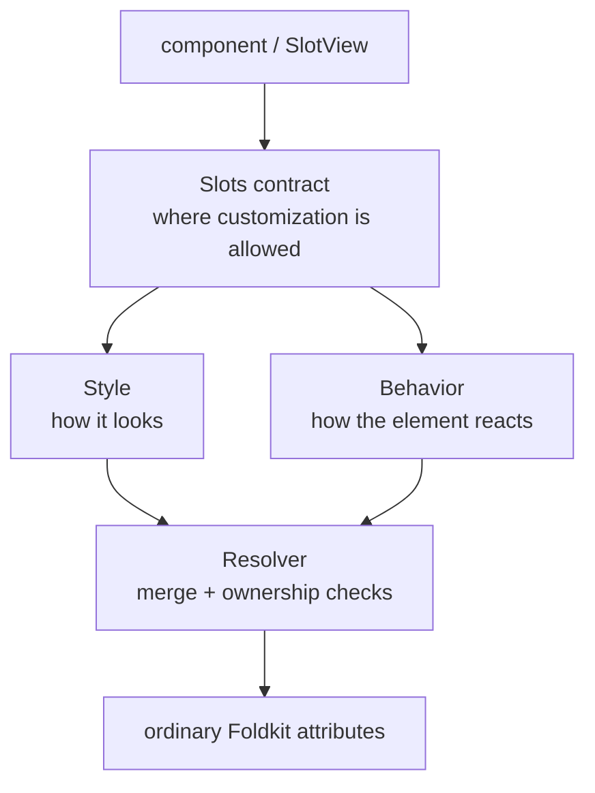
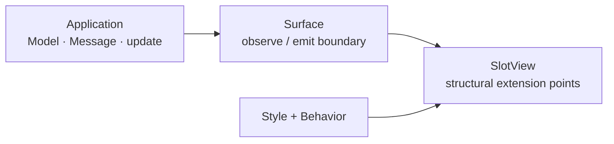

# Inside-out view composition: `foldkit-mixins`

A reusable button or field starts simple, then accumulates props (`className`, `iconClassName`, `compact`, `showTooltip`, `trackClick`, `ariaLabelOverride`) until the component owns every design-system and feature concern. The alternative—copying the render function at each call site—throws away reuse.

`foldkit-mixins` solves this with **typed extension points** called **Slots**. A component author declares named structural points (`root`, `input`, `label`) once, and callers attach **Styles** (appearance) and **Behaviors** (attributes and mounts) from the outside without editing the component's markup or adding props.

## Five concepts that fit together

| Term | Role |
| --- | --- |
| **Slot** | One named extension point in a view |
| **Slots** | Contract listing all slots and what each permits |
| **Style** | External appearance: classes, styles, and CSS rules |
| **Behavior** | External DOM interaction: attributes and optional `Mount` |
| **SlotView** | Pure Foldkit view rendering through those slots |

Style and Behavior both compile to `Mixin` values. Before Foldkit renders attributes, the resolver merges all attached mixins and enforces single-owner conflict rules.



## Why Slots beat `className` props

A plain `className` prop only injects CSS strings without saying what element it targets, which events exist, or which attributes are structural. A Slot contract specifies:

- **Capability:** Whether the slot is a `Container`, `Interactive` control, `Focusable` item, or `TextInput`.
- **Published events and attributes:** Which events (such as `Event.Input`) and ARIA attributes (such as `Attr.AriaInvalid`) attachments may rely on or supply.
- **Protected members:** Structural roles or attributes (like `role`) that external attachments cannot overwrite.

When a Behavior declares `requires: { capability: Capability.TextInput, attributes: [Attr.AriaInvalid] }`, attaching it to an incompatible slot fails at definition time rather than silently breaking at runtime. Contracts also export serializable metadata for DevTools, tests, and documentation.

## Separating Style from Behavior

`foldkit-mixins` keeps visual rules and element interactions separate:

- **Style** is pure CSS data: classes, recipes, themes, pseudo-classes, media queries, and container queries.
- **Behavior** is reusable DOM interaction: tooltip wiring, analytics click tracking, ARIA decoration, keyboard routing, focus management, `ResizeObserver`, or intersection observers.

Behaviors contribute attributes and an optional Foldkit `Mount`, leaving application state in your Foldkit `Model`, `Message`, and `update`. When an interaction needs persistent state (such as open/closed or active index), place a primitive `Bundle` from `foldkit-primitives` in your `Model` rather than hiding mutable state inside a mount.

## A first slotted field

First, declare the component's slots (`root` and `input`):

<!-- docs-check standalone
import { Schema } from 'effect'
import { defineMessageUnion } from 'foldkit/message'
const Message = defineMessageUnion({ ChangedValue: { value: Schema.String } })
type Message = typeof Message.Type
type FieldInput = { readonly value: string; readonly invalid: boolean }
-->
```ts
import { Attr, Behavior, Capability, Event, Slot, Slots, SlotView, Style } from 'foldkit-mixins'

const FieldSlots = Slots.define({
  root: Slot.make({ capability: Capability.Container }),
  input: Slot.make({
    capability: Capability.TextInput,
    events: [Event.Input],
    attributes: [Attr.AriaInvalid],
  }),
})
```

Next, define a `Style` for appearance and a `Behavior` for validation attributes independently:

```ts
const FieldStyle = Style.forSlots(FieldSlots)({
  root: Style.class('field'),
  input: Style.class('field-input'),
})

const Validation = Behavior.forSlots(FieldSlots)<FieldInput, Message>({
  input: Behavior.slot({
    requires: { capability: Capability.TextInput, attributes: [Attr.AriaInvalid] },
    attributes: ({ input, h }) => [h.AriaInvalid(input.invalid)],
  }),
})
```

Finally, render the `SlotView` and pipe both attachments onto it:

```ts
const Field = SlotView.forMessages<Message>()
  .define(FieldSlots, (input: FieldInput, slots, h) =>
    h.label(slots.root.attrs(), [
      h.input(
        slots.input.attrs([
          h.Value(input.value),
          h.OnInput(value => Message.ChangedValue({ value })),
        ]),
      ),
    ]),
  )
  .pipe(Style.attach(FieldStyle), Behavior.attach(Validation))
```

Each participant keeps a single responsibility: the component author owns stable extension points, the style author owns appearance, the feature author owns element behavior, the Foldkit app owns `Model` and `update`, and the resolver enforces conflict checks.

## How the resolver prevents attachment conflicts

Instead of concatenating attributes in render order, the resolver enforces clear ownership rules:

- **Classes:** Merged additively and deduplicated.
- **Inline styles:** Merged per CSS property.
- **Events and scalar attributes:** Single owner per slot; a second handler emits a diagnostic instead of silently overwriting.
- **Structural keys:** `Key` and `InnerHTML` stay protected from overrides.
- **Mounts:** Multiple mounts on one slot compose into a single `OnMount`.

For keyboard events (`keydown`), widgets and callers compose through named **routes** in `Behaviors.Keys`. A widget exposes a `routes` option so callers add key bindings cleanly; colliding chords throw `mixins:key-conflict` unless resolved explicitly with `Keys.first`. See [Keys: one owner for a slot's keydown](../packages/mixins/README.md#keys-one-owner-for-a-slots-keydown).

## Capabilities, permissions, and protected slots

Every `Slot` declaration captures:

- A hierarchical **Capability** (`TextInput` satisfies a requirement for `Interactive`).
- Published **Event** and **Attr** tokens.
- Platform **Requirement** tokens (Keyboard, Pointer, Clipboard).
- Whether the slot is `hidden` from external callers or marks specific events/attributes `protected`.

Use `.make` constructors to define custom capabilities, events, and attributes when needed.

## Composing Slots with `foldkit-surface`

`Surface` and `Slots` govern orthogonal boundaries: `Surface` restricts which `Model` fields a feature reads and which `Message` variants it emits, while `Slots` defines which DOM points callers may customize.



`foldkit-mixins-surface` bridges both so a `SlotView` receives a typed `Projection` and narrowed `Message` builder without requiring `Surface` to use `foldkit-mixins` elsewhere.

## Adapting `@foldkit/ui` components

`foldkit-mixins-ui` brings the same Slot, Style, and Behavior model to `@foldkit/ui` widgets (Button, Input, Checkbox, Disclosure, Dialog, Popover, Tooltip, Tabs, RadioGroup, Calendar, HoverIntent, FileDrop, VirtualList, Meter, Progress, Nav, and Anchor):

1. **Direct adapters:** Most `@foldkit/ui` components pass typed attribute bundles to `toView`, which the adapter maps directly to named Slots.
2. **Forked seams:** Components that construct inner elements without `toView` (`Menu`, `Listbox`, `ComboBox`, `DatePicker`, `Toast`) adapt the upstream view structure to expose Slots while keeping upstream state and `update`.
3. **Native `foldkit-mixins-ui` views:** Widgets with requirements beyond upstream (such as two-thumb `Slider`, toolbars, search fields, and data tables) render directly from Slots and `foldkit-primitives`.

## Structural and rendered accessibility checks

`A11y.pattern` verifies that a component's Slots satisfy structural accessibility requirements purely from data:

<!-- docs-check
const DialogSlots = Slots.define({
  trigger: Slot.make({ capability: Capability.Interactive, events: [Event.Click] }),
  content: Slot.make({ capability: Capability.Container }),
})
-->
```ts
import { A11y } from 'foldkit-mixins'

const DialogPattern = A11y.pattern({
  trigger: { capability: Capability.Interactive, events: [Event.Click] },
  content: { capability: Capability.Container },
})

A11y.validate(DialogPattern, DialogSlots)
```

Patterns can also declare **obligations** (`A11y.Navigation`, `A11y.FocusStrategy`, `A11y.Activation`, `A11y.State(attr)`, `A11y.Name`) satisfied by Behaviors, `A11y.base`, `A11y.native`, or `A11y.delegated`. Adding `A11y.conform(pattern)` checks at compile time and module load (`a11y:unsatisfied-obligation`) that every obligation has a supplier.

To verify real DOM behavior—focus movement, keyboard interaction, and Chromium's accessibility tree—run `Conformance` scenarios (`listbox`, `tree`, `dialog`, `tabs`, `checkbox`) from `foldkit-mixins/testing`. See [Obligations](../packages/mixins/README.md#obligations-who-does-what-a-pattern-asks) and [Conformance](../packages/mixins/README.md#conformance-the-rendered-check).

## Compiling Style rules as data

Rule-based `Style` (`Style.pseudo`, `media`, `supports`, `container`, `nest`) hashes deterministic rule trees into stable class names, producing identical CSS on server and browser without runtime collectors. Collect and deduplicate all rules into your app stylesheet with `Style.stylesheet(...)`. Dynamic styles choose among static pieces via `Style.whenInput` so rule graphs stay finite.

## Introspecting Slots and Mixins

`Slots.describe`, `Slot.describe`, and `SlotView.describe(view)` export serializable metadata listing every slot, attachment, requirement, and provided obligation—useful for tests, DevTools, and generated documentation—while resolver conflicts emit structured diagnostic codes.

## Limits

- Customization attaches only to published Slots; internal markup stays encapsulated.
- Behaviors attach DOM attributes and mounts; persistent state belongs in your `Model` or a `foldkit-primitives` Bundle.
- Your application installs the stylesheet generated by `Style.stylesheet(...)`.
- Components without a render/attribute seam cannot be adapted without adding Slots.
- `A11y.validate` and `A11y.conform` check declared contracts; use `Conformance` browser tests to verify rendered accessibility behavior (neither constitutes legal WCAG certification).

## Next

- Walk through building a custom component end to end in [Authoring components](./authoring-components.md).
- Explore working examples in [`examples/mixins`](../examples/mixins), [`examples/todo-app`](../examples/todo-app), and [`examples/remote`](../examples/remote).
- Read the package APIs in [`foldkit-mixins`](../packages/mixins/README.md), [`foldkit-primitives`](../packages/primitives/README.md), [`foldkit-mixins-ui`](../packages/mixins-ui/README.md), and [`foldkit-mixins-surface`](../packages/mixins-surface/README.md).
